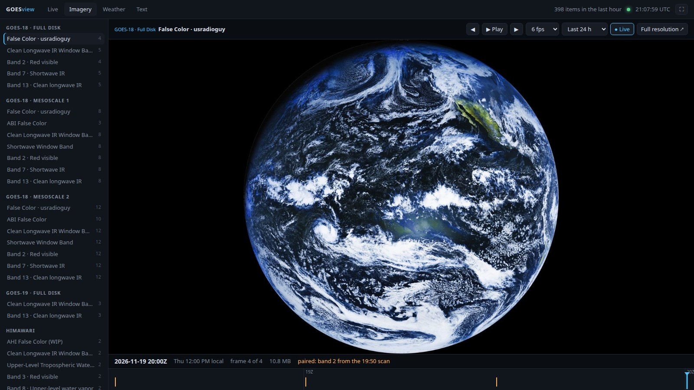

# GOESview

A live viewer for [SatDump](https://github.com/SatDump/SatDump) GOES HRIT output.
Point it at the folder SatDump is writing into and open a browser: new images,
weather products and text bulletins appear as they are received.

- **Live** dashboard built for a wall display: latest full-disk colour image,
  the most recently updated products, reception rate, disk space, bulletins.
- **Imagery** and **Weather** by group (full disk, mesoscale, Level 2, NWS
  charts, EMWIN graphics), either the latest of each type or everything in
  the order it arrived. Processed composites and raw channels can be filtered.
- **Timeline** for every image type: scrub, play, zoom and pan, map overlay,
  follow new frames live.
- **Text**: the EMWIN feed as it arrives, by product type or office, with
  full-text search across every bulletin.
- **False colour that survives split scans.** SatDump only builds its colour
  composite when band 2 and band 13 land in the same timestamp folder, and the
  HRIT feed regularly files one of them under the previous scan. goesview pairs
  them back up and builds the frame itself.
- **Bulletin archive**: optionally packs each finished day's text bulletins
  into one zip, which saves a great deal of space on large-cluster drives.
- **Retention**: keeps its own cache trimmed, and can optionally delete the
  oldest SatDump data by age, size, or disk use. It never deletes SatDump's
  files unless you ask for that explicitly.

Python standard library for serving, Pillow for previews, numpy for false
colour. No build step, no JavaScript dependencies. It never writes inside the
SatDump folder, and never deletes from it unless you give a `--satdump-*`
retention option.

## Install

Needs Python 3.10 or newer.

    sudo apt install python3-pil python3-numpy
    git clone https://github.com/jstockdale/goesview.git ~/goesview

## Run

Point it at the folder that **contains** SatDump's timestamped run folder, not
the run folder itself. SatDump starts a new run folder each time it restarts,
and goesview picks up every run underneath.

    python3 ~/goesview/goesview.py /path/to/satdump-output --port 8000

Then open `http://<host>:8000/`.

Previews and the colour frames it builds go to `~/.cache/goesview` (change with
`--cache`). On first start it builds colour frames for the last 72 hours and
previews for the last 24; on a small machine shorten that with
`--colour-hours 12 --warm-hours 6 --workers 1`.

| Option | Default | Meaning |
|---|---|---|
| `--port` | 8000 | Port to listen on. |
| `--lut` | usradioguy | Colour table: `usradioguy`, `wxstar`, a PNG path, or `none`. |
| `--colour-hours` | 72 | Build colour frames for slots this recent. |
| `--warm-hours` | 24 | Pre-render previews for images this recent. |
| `--workers` | 2 | Concurrent preview renders. |
| `--satdump-api` | off | URL of SatDump's own HTTP stats, to show signal numbers on the Live page. |
| `--no-text-index` | | Skip the full-text search index for the Text page. |

`--help` lists everything.

The Text page's search box looks through the full text of every bulletin as
well as product and office codes: every word must appear, and a phrase in
quotes must match exactly. The index behind it lives in the cache folder as
`text-index-2.sqlite3`. It records only which bulletins contain which words,
so it is a few percent of the size of the bulletin text; excerpts are read
from the bulletins themselves. It is built in the background on first start
and kept current after that.

## Retention

GOESview handles two kinds of files, and treats them very differently.

**Its own cache** (previews and colour frames, under `--cache`). These are
rebuilt from SatDump's data whenever needed, so deleting them loses nothing.
By default GOESview deletes cached files older than 30 days.

| Option | Example | Meaning |
|---|---|---|
| `--cache-keep AGE` | `14d`, `3mo`, `off` | Delete cached files older than this. Default `30d`; `off` keeps them forever. |
| `--cache-max-size SIZE` | `500M`, `20G` | Keep the cache under this size. |
| `--cache-disk-cap N%` | `90%` | When the disk is fuller than this, delete the oldest cached files. |

**SatDump's received data.** This cannot be recovered once deleted, so
**GOESview never deletes it unless you ask by name.** None of these options has
a default:

| Option | Example | Meaning |
|---|---|---|
| `--satdump-keep AGE` | `30d`, `3mo`, `1y` | Delete SatDump data older than this. |
| `--satdump-max-size SIZE` | `200G`, `1.5T` | Keep the SatDump folder under this size. |
| `--satdump-disk-cap N%` | `90%` | When the disk is fuller than this, delete the oldest SatDump data. |
| `--satdump-protect FOLDER` | | Never delete from this run folder. May be repeated. |
| `--satdump-include FOLDER` | | Also treat this folder as a GOES HRIT run, if you named it yourself. May be repeated. |

    python3 ~/goesview/goesview.py /path/to/satdump-output --satdump-keep 3mo --satdump-disk-cap 90% --prune-dry-run

What the SatDump options can and cannot reach:

- **Only GOES HRIT run folders.** That means folders directly under the one
  you point GOESview at that carry SatDump's own name for such a run
  (`..._goes_hrit_...`), old runs as well as the current one. Old runs are
  included on purpose: SatDump starts a new run folder each time it restarts,
  so the oldest data usually sits in an old run.
- **Nothing else in that folder is ever touched**: runs from other satellites
  or pipelines, baseband recordings, folders you made yourself, loose files.
  A folder you named yourself is left alone even if it holds GOES images,
  unless you add it with `--satdump-include`.
- **Inside a run, only recognised SatDump products go**: timestamp folders
  under `IMAGES/` and `L2/`, EMWIN files and NWS charts. A timestamp folder
  that contains anything SatDump did not write is left whole.
- **You are told what is covered.** The startup log lists the run folders the
  limits apply to and the items they never touch, and the Live page shows the
  same under Storage.

How they behave:

- Deletion is always oldest first. The previews and colour frames made from
  deleted data go with it.
- Limits combine: `--satdump-keep 3mo --satdump-disk-cap 90%` keeps three
  months unless the disk gets tight, then trims further.
- Data from the last 3 hours is never deleted, whatever the limits say. If a
  limit cannot be met without that, it logs a warning instead.
- Ages count back from the newest data received, not from the wall clock, so a
  wrong system clock or a long outage cannot make the whole archive look old.

`--prune-dry-run` makes both kinds log what they would delete and delete
nothing; `--prune-every MIN` sets how often it looks (default 10 minutes). The
Live page shows free space, both policies and the last sweep of each. The log
states at startup whether SatDump's data can be deleted:

    retention, SatDump data: never deleted (no --satdump-* option given)

## Bulletin archive

EMWIN sends tens of thousands of small text bulletins a day, and SatDump writes
each as its own file. On drives with large clusters (exFAT especially) every
one of them takes far more space than its length, and a folder with hundreds
of thousands of files slows down everything that writes into it.

With `--archive-bulletins`, GOESview packs each finished day's bulletins into
one zip and removes the loose files:

    <run folder>/EMWIN-archive/2026-11-18.zip

- **Today's bulletins stay ordinary files.** A day is packed an hour after it
  ends (UTC), so SatDump is never writing into anything being packed.
- **Nothing is deleted until it is proven safe.** The zip is written to a
  temporary file, flushed to disk, read back and compared byte for byte with
  the originals, and moved into place. Only then do the loose files go. If
  any step fails, they stay.
- **Nothing changes in the viewer.** Archived bulletins are listed, shown,
  linked and searched exactly as before.
- **The archives are plain zip files** holding the bulletins under their
  original names. `unzip` gets them back without GOESview.
- **Retention covers them.** The `--satdump-*` limits treat each day's zip as
  one unit.

It is off by default, because it removes files SatDump wrote. It only works
inside GOESview's idea of a GOES HRIT run folder (see Retention), honours
`--satdump-protect`, touches nothing but EMWIN `.txt` bulletins, and with
`--prune-dry-run` only reports what it would pack.

## Colour tables

The false-colour tables are not included in this repository. goesview uses the
copies SatDump installs, looking in `/usr/share/satdump/resources/lut/goes/abi`
and `/usr/local/share/satdump/resources/lut/goes/abi`:

| `--lut` | File |
|---|---|
| `usradioguy` (default) | `usradioguycustomlut.png`, the table from [usradioguy.com](https://usradioguy.com/custom-color-lookup-table/) |
| `wxstar` | `wxstar/lut.png`, SatDump's stock table |
| (band 2 curve) | `wxstar/ch2_curve.png` |

If your SatDump lives elsewhere, copy those three files into `luts/` next to
`goesview.py` as `usradioguy.png`, `wxstar.png` and `ch2_curve.png`, or pass a
path with `--lut`. Without a table the viewer still runs, minus its own colour
frames.

## Start at boot

Edit the values marked `EDIT` in `goesview.service`, then:

    sudo cp ~/goesview/goesview.service /etc/systemd/system/
    sudo systemctl daemon-reload
    sudo systemctl enable --now goesview
    journalctl -u goesview -f

## Colour images without the viewer

`pair_false_color.py` does the pairing on its own and writes PNGs:

    python3 ~/goesview/pair_false_color.py "/path/to/run/IMAGES/GOES-18/Full Disk" --dry-run

Without `--dry-run` it writes `abi_rgb_ABI_False_Color_usradioguy.png` into
each slot folder SatDump left without a colour image. `--all` builds every
slot; `--lut learn` copies whatever colours your SatDump already produces.

## Notes

Written against SatDump 1.2 output from GOES-18 HRIT (which also relays
GOES-19 and Himawari imagery). Other GOES satellites should work unchanged;
other SatDump pipelines will show up as generic image types.

BSD-3-Clause licensed. Not affiliated with SatDump, NOAA or usradioguy.com.
