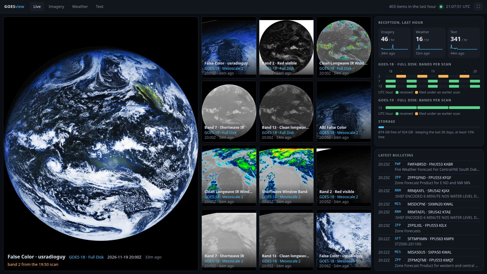

# GOESview

A live viewer for [SatDump](https://github.com/SatDump/SatDump) GOES HRIT output.
Point it at the folder SatDump is writing into and open a browser: new images,
weather products and text bulletins appear as they are received.

- **Live** dashboard built for a wall display: latest full-disk colour image,
  the most recently updated products, reception rate, disk space, bulletins.
- **Imagery** and **Weather** by group (full disk, mesoscale, Level 2, NWS
  charts, EMWIN graphics), either the latest of each type or everything in
  the order it arrived. Processed composites and raw channels can be filtered.
- **Timeline** for every image type: scrub, play, zoom and pan, map overlay,
  follow new frames live.
- **Text**: the EMWIN feed as it arrives, by product type or office.
- **False colour that survives split scans.** SatDump only builds its colour
  composite when band 2 and band 13 land in the same timestamp folder, and the
  HRIT feed regularly files one of them under the previous scan. goesview pairs
  them back up and builds the frame itself.
- **Retention**: optionally delete the oldest data by age, total size, or free
  disk space.

Python standard library for serving, Pillow for previews, numpy for false
colour. No build step, no JavaScript dependencies. It never writes inside the
SatDump folder unless you turn retention on.

## Install

Needs Python 3.10 or newer.

    sudo apt install python3-pil python3-numpy
    git clone https://github.com/jstockdale/goesview.git ~/goesview

## Run

Point it at the folder that **contains** SatDump's timestamped run folder, not
the run folder itself. SatDump starts a new run folder each time it restarts,
and goesview picks up every run underneath.

    python3 ~/goesview/goesview.py /path/to/satdump-output --port 8000

Then open `http://<host>:8000/`.

Previews and the colour frames it builds go to `~/.cache/goesview` (change with
`--cache`). On first start it builds colour frames for the last 72 hours and
previews for the last 24; on a small machine shorten that with
`--colour-hours 12 --warm-hours 6 --workers 1`.

| Option | Default | Meaning |
|---|---|---|
| `--port` | 8000 | Port to listen on. |
| `--lut` | usradioguy | Colour table: `usradioguy`, `wxstar`, a PNG path, or `none`. |
| `--colour-hours` | 72 | Build colour frames for slots this recent. |
| `--warm-hours` | 24 | Pre-render previews for images this recent. |
| `--workers` | 2 | Concurrent preview renders. |
| `--satdump-api` | off | URL of SatDump's own HTTP stats, to show signal numbers on the Live page. |

`--help` lists everything.

## Retention

Off by default. Give one or more limits and goesview deletes the **oldest
received data from the SatDump folder** to stay within them:

| Option | Example | Meaning |
|---|---|---|
| `--keep AGE` | `36h`, `14d`, `2w`, `3mo`, `1y` | Delete data older than this. |
| `--max-size SIZE` | `500M`, `200G`, `1.5T` | Keep the SatDump folder under this size. |
| `--min-free SIZE\|N%` | `20G`, `10%` | Keep at least this much of the disk free. |
| `--prune-every MIN` | `10` | Minutes between sweeps. |
| `--prune-dry-run` | | Log what would be deleted and delete nothing. |

    python3 ~/goesview/goesview.py /path/to/satdump-output --keep 14d --min-free 10% --prune-dry-run

How it behaves:

- It removes whole timestamp folders under `IMAGES/` and `L2/`, and single
  files in `EMWIN/` and `IMAGES/NWS/`, always oldest first. Previews and
  colour frames made from deleted data go with them.
- Limits combine: `--keep 30d --min-free 10%` keeps a month unless the disk
  gets tight, then trims further.
- Data from the last 3 hours is never deleted, whatever the limits say. If a
  limit cannot be met without that, it logs a warning instead.
- Ages count back from the newest data received, not from the wall clock, so a
  wrong system clock or a long outage cannot make the whole archive look old.
- The Live page shows free space, the active limits and the last sweep.

Run with `--prune-dry-run` first and read the log.

## Colour tables

The false-colour tables are not included in this repository. goesview uses the
copies SatDump installs, looking in `/usr/share/satdump/resources/lut/goes/abi`
and `/usr/local/share/satdump/resources/lut/goes/abi`:

| `--lut` | File |
|---|---|
| `usradioguy` (default) | `usradioguycustomlut.png`, the table from [usradioguy.com](https://usradioguy.com/custom-color-lookup-table/) |
| `wxstar` | `wxstar/lut.png`, SatDump's stock table |
| (band 2 curve) | `wxstar/ch2_curve.png` |

If your SatDump lives elsewhere, copy those three files into `luts/` next to
`goesview.py` as `usradioguy.png`, `wxstar.png` and `ch2_curve.png`, or pass a
path with `--lut`. Without a table the viewer still runs, minus its own colour
frames.

## Start at boot

Edit the values marked `EDIT` in `goesview.service`, then:

    sudo cp ~/goesview/goesview.service /etc/systemd/system/
    sudo systemctl daemon-reload
    sudo systemctl enable --now goesview
    journalctl -u goesview -f

## Colour images without the viewer

`pair_false_color.py` does the pairing on its own and writes PNGs:

    python3 ~/goesview/pair_false_color.py "/path/to/run/IMAGES/GOES-18/Full Disk" --dry-run

Without `--dry-run` it writes `abi_rgb_ABI_False_Color_usradioguy.png` into
each slot folder SatDump left without a colour image. `--all` builds every
slot; `--lut learn` copies whatever colours your SatDump already produces.

## Notes

Written against SatDump 1.2 output from GOES-18 HRIT (which also relays
GOES-19 and Himawari imagery). Other GOES satellites should work unchanged;
other SatDump pipelines will show up as generic image types.

BSD-3-Clause licensed. Not affiliated with SatDump, NOAA or usradioguy.com.
